# zFinancas

<p align="center">
  
</p>

Controle financeiro pessoal **offline** em **.NET MAUI** para **Windows** e **Android**.
Domínio testável, SQLite local e sincronização por arquivo entre PC e celular — sem nuvem,
sem telemetria e sem depender de internet.

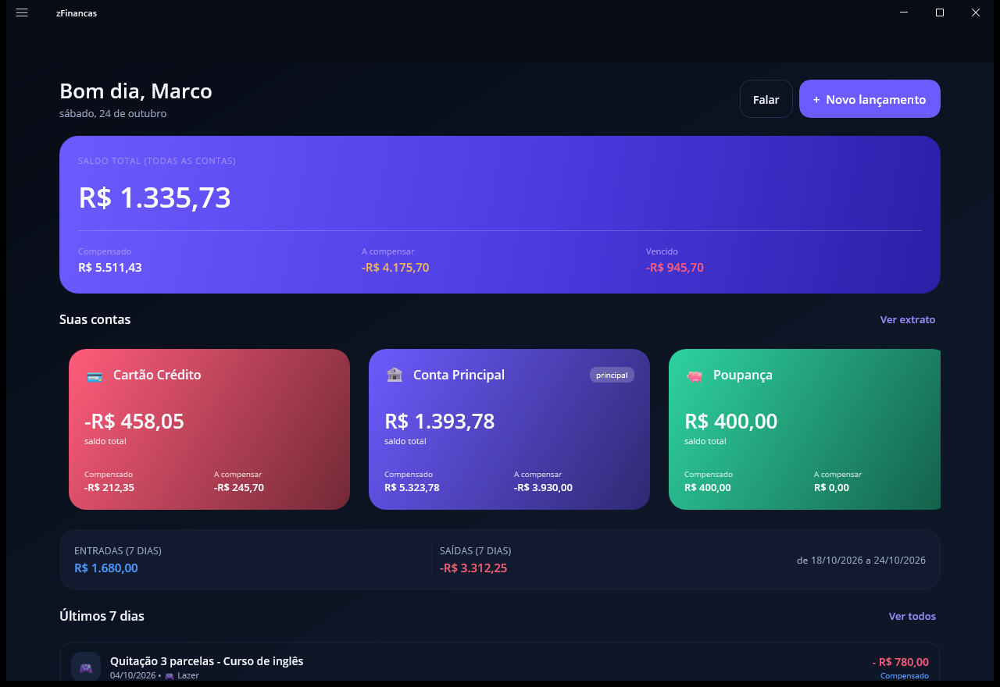


## Identidade visual

| Peça | Onde | Arquivo |
| --- | --- | --- |
| Ícone do app | launcher Android / atalho Windows | `Resources/AppIcon/appicon.png` (+ `appiconfg.png`) |
| Splash do sistema | abertura fria | `Resources/Splash/splash.png` (fundo `#0B1020`) |
| Abertura animada | primeiros 1,6 s (fade + escala) | `Pages/AberturaPage` + `simbolo.png` |
| Logotipo claro | login e abertura | `Resources/Images/logotipoclaro.png` |
| Símbolo | cabeçalho do dashboard | `Resources/Images/simbolo.png` |

> **Troquei a arte e o ícone não muda?** O `resizetizer` do MAUI guarda o resultado em
> `obj\Debug\net9.0-android` e pode reaproveitar o ícone antigo. Limpe e reconstrua:
>
> ```powershell
> .\build.ps1 -Target android -Clean
> ```
>
> Depois reinstale (`adb install -r`) e reinicie o launcher do aparelho.

A versão clara do logotipo existe porque o texto original é azul-marinho e desaparece no
tema escuro: os pixels escuros foram remapeados para `#F4F7FF`, mantendo o símbolo colorido.

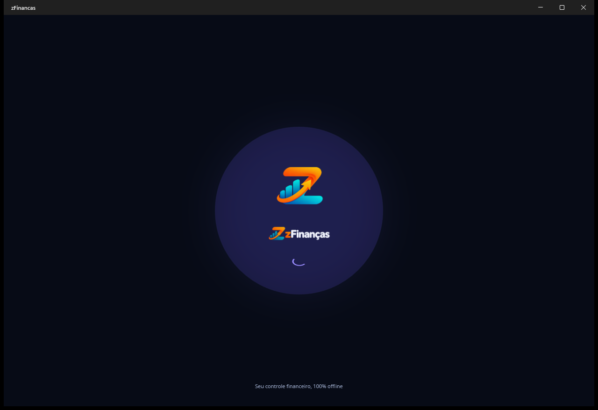

## Detalhes que valem saber

**Biometria (Android).** Exige `USE_BIOMETRIC` no manifest; o prompt é o nativo
(`BiometricPrompt`) com botão “Cancelar” — sem ele o Android recusa construir o diálogo.
Depois de ativada em Configurações, a digital é pedida automaticamente ao abrir o login.

**Campo de valor.** Máscara de moeda: os dígitos entram como centavos (`3250` → `32,50`).
A escrita no `EditText` é feita no `TextChanged` com o handler desconectado e o cursor
reposicionado depois — sem isso, o AndroidX Emoji2 estoura
`end should be < than charSequence length` ao digitar.

**Sincronização.** Nenhum registro é apagado por “não existir do outro lado”: a mesclagem é
por UUID, com `ATUALIZADOEM` decidindo empates e lápides propagando exclusões. Bases criadas
separadamente que geraram a mesma conta/centro/usuário (nomes iguais, UUIDs diferentes) são
**unificadas** na primeira importação, com aviso na tela.

## O que já está pronto

| Tela | O que faz |
| --- | --- |
| **Login** | seleção de usuário, senha, dica de senha e **biometria** (digital/rosto, pedida automaticamente) |
| **Primeiro acesso** | cria o usuário ADM, semeia conta e centro de custo principais e entrega o código de recuperação |
| **Dashboard** | carrossel de contas, saldo compensado / a compensar / vencido, entradas e saídas e últimos 7 dias |
| **Lançamentos** | filtros por contas/pendência/busca, **Compensar** direto na linha (data escolhida), descompensar, excluir uma ou várias parcelas e quitar parcelas escolhidas |
| **Lançamento por voz** | toque no microfone e fale: “gastei 32,50 no mercado ontem” — o formulário abre preenchido (descrição limpa de “mil”, “reais”, “R$”) |
| **Novo lançamento** | despesa ou recebimento, recorrência (semanal, quinzenal, mensal, anual) com parcelas e agrupador; valor com **máscara de moeda** (digite 3250 → 32,50) |
| **Extrato** | conta + período, saldo anterior (só compensados), saldo linha a linha e destaque dos pendentes |
| **Contas correntes** | CRUD com cor e ícone; menu `⋯` para editar, definir principal e **ativar/desativar** |
| **Centros de custo** | CRUD com ícone (emoji), centro principal único |
| **Usuários** | perfis ADM/USR e vínculo com contas; menu `⋯` para editar, redefinir senha e **ativar/desativar** |
| **Sincronização** | exporta (diálogo nativo “Salvar como”) e importa pacote `.zfsync`, com resolução de conflito e unificação de registros homônimos |
| **Configurações** | conta padrão, biometria, **backup/restauração**, **começar do zero**, informações do aparelho e sair |

## Backup e instalação

- **Backup** em Configurações → BACKUP: gera uma cópia completa do banco (VACUUM INTO) pelo
  diálogo nativo de salvar, e restaura validando cabeçalho, integridade e versão do esquema
  antes de substituir — guardando uma cópia do banco anterior. Detalhes em
  [docs/BACKUP.md](docs/BACKUP.md).
- **Publicação**: `.\build.ps1 -Publish` gera `.tmp\publicacao\win-x64` (self-contained) e
  `zFinancas-win-x64.zip`.
- **Instalador Windows**: `instalador\zFinancas.iss` (Inno Setup 6) — passo a passo em
  [instalador/LEIA-ME.md](instalador/LEIA-ME.md).

## Estrutura

```
zFinancas.sln
├── src/zFinancas.Core      domínio + aplicação (sem dependências externas)
├── src/zFinancas.Data      SQLite: schema versionado, repositórios, JSON
├── src/zFinancas.App       .NET MAUI (Windows + Android): telas, view models, serviços
├── tests/zFinancas.Tests   70 testes (domínio, serviços, voz e sincronização em duas pontas)
├── tools/zFinancas.Demo    gera banco de demonstração
└── tools/zFinancas.TestRunner  runner de testes sem vstest
```

A dependência aponta sempre para dentro: `App → Data → Core`. O domínio não conhece
SQLite, MAUI nem qualquer detalhe de infraestrutura.

## Como executar

Pré-requisitos: **.NET SDK 9** (o `global.json` fixa 9.0.305) e workloads
`maui-windows` / `maui-android`.

```powershell
# compila o desktop
.\build.ps1

# abre o app com dados de demonstração (3 contas, 21 lançamentos, séries e quitação)
.\build.ps1 -Demo -Run

# abre o app com o banco real do usuário
.\build.ps1 -Run

# roda a suíte de testes
.\build.ps1 -Test

# compila o APK Android
.\build.ps1 -Target android

# publica o app para distribuição (self-contained + ZIP)
.\build.ps1 -Publish
```

Ou direto com `dotnet`:

```powershell
dotnet build src\zFinancas.App -f net9.0-windows10.0.19041.0
dotnet test  tests\zFinancas.Tests
dotnet run   --project tools\zFinancas.Demo
```

### Abrindo no Visual Studio

1. Abra `zFinancas.sln` (VS 2022 17.12+ ou VS 2026) — o `global.json` fixa o SDK em **9.0.305**,
   então o VS precisa do .NET 9 + workloads MAUI instalados.
2. O VS vai restaurar os pacotes do **nuget.org** (o cache local do `build.ps1` fica em
   `.dotnetcli\` e é exclusivo do script) — na primeira abertura é preciso internet para
   baixar o `CommunityToolkit.Maui 12.1.0`.
3. Marque **zFinancas.App** como projeto de inicialização e escolha o alvo:
   - `net9.0-windows10.0.19041.0` → F5 roda no PC (primeira execução abre o **Primeiro acesso**);
   - `net9.0-android` → escolha dispositivo/emulador (precisa de **JDK 17** e plataforma
     **android-35**); aceite a permissão de microfone quando o app pedir.
4. Para ver o app já com dados: rode `tools\zFinancas.Demo` e aponte `ZFINANCAS_DB` para o
   arquivo gerado (ou use `.\build.ps1 -Demo -Run` no terminal).

### Contas do banco de demonstração

| Perfil | Usuário | Senha | Acesso |
| --- | --- | --- | --- |
| ADM | Marco Aurélio | `demo1234` | todas as contas |
| USR | Ana | `ana1234` | apenas a conta Poupança |

### Variáveis de ambiente (desenvolvimento)

| Variável | Efeito |
| --- | --- |
| `ZFINANCAS_DB` | caminho alternativo do arquivo SQLite (ex.: banco de demonstração) |
| `ZFINANCAS_AUTOLOGIN` | *(apenas Debug)* entra direto com o nome ou id do usuário |
| `ZFINANCAS_SECAO` | *(apenas Debug)* abre direto uma seção: `dashboard`, `lancamentos`, `extrato`, `contas`, `centros-custo`, `usuarios`, `sincronizacao`, `configuracoes`, `novo-lancamento`, `novo-usuario` |
| `ZFINANCAS_VOZ` | *(apenas Debug)* simula a fala, ex.: `"gastei 32,50 no mercado ontem"` — testa a voz sem microfone |
| `ZFINANCAS_MENU` | *(apenas Debug)* simula o clique em um item do menu: `dashboard`, `lancamentos`, `extrato`, `contas`, `centros-custo`, `usuarios`, `sincronizacao`, `configuracoes` |

## Lançamento por voz (Speech-to-Text)

No **Dashboard** (botão `Falar`) ou no formulário (botão `Falar e preencher`), toque no
microfone e fale o lançamento. Nada é gravado sem sua confirmação: a tela de cadastro abre
já preenchida para revisão.

O reconhecimento usa o `SpeechToText` do **.NET MAUI Community Toolkit**, que aciona o
reconhecedor nativo do aparelho (Google no Android, Windows Speech no desktop) — nenhum
áudio sai do aparelho e não há serviço em nuvem.

Depois de capturado o texto, um **interpretador próprio** ([InterpretadorDeVoz](src/zFinancas.Core/Dominio/Voz/InterpretadorDeVoz.cs)),
puro e testável, extrai:

| A informação | Exemplos |
| --- | --- |
| tipo | “**gastei**”, “**paguei**”, “**comprei**” → despesa; “**recebi**”, “**ganhei**”, “**entrou**” → recebimento |
| valor | `32,50` · `1.234,56` · `1200` · “**cinquenta**” · “**cento e vinte e cinco**” · “**2 mil**” |
| data | “**hoje**” (padrão), “**ontem**”, “**anteontem**”, “**amanhã**” |
| centro de custo | pelo nome cadastrado (“no **lazer**”) ou por palavra-chave (“**mercado**” → Alimentação, “**gasolina**” → Transporte, “**farmácia**” → Saúde, “**aluguel**” → Moradia) |
| situação | “**vou pagar**”, “**vence**”, “**pendente**” → não compensado; caso contrário já compensado |
| descrição | o restante da frase, sem palavras de ligação nem o valor |

Frases que funcionam de primeira:

```
“gastei 32,50 no mercado ontem”      → Despesa  R$ 32,50   Mercado        Alimentação  (22/10)
“recebi 1.200 de freelance”          → Recebimento R$ 1.200  Freelance     Geral
“paguei cinquenta reais de aluguel”  → Despesa  R$ 50,00   Aluguel        Moradia
“vou pagar 300 de condomínio”        → Despesa  R$ 300,00  Condomínio     Moradia  (pendente)
```

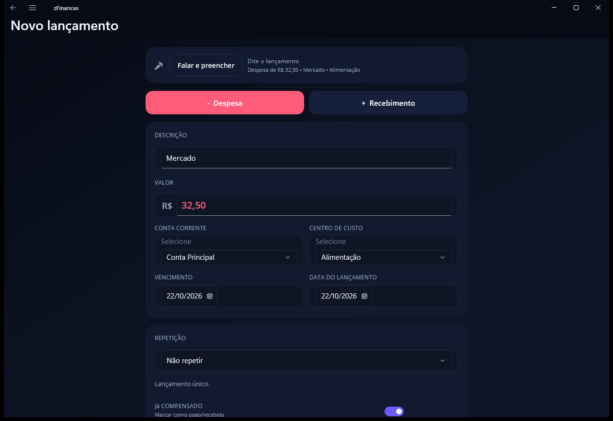

Permissões: no Android o app declara `RECORD_AUDIO` e o `queries` do serviço de
reconhecimento; no Windows é usado o reconhecedor do sistema (precisa de microfone e do
idioma português instalado).

## Primeiro acesso e recuperação de senha

1. Na primeira execução o app detecta que não há usuários e abre o cadastro do **ADM**.
2. O ADM cria conta corrente e centro de custo principais automaticamente.
3. No fim do cadastro é exibido o **código de recuperação** (ex.: `ABCD-EFGH-JKLM`).
   Ele é mostrado **uma única vez** e guardado apenas como hash.
4. Esqueceu a senha? `Esqueci a senha` → nome + código + nova senha. O código é de uso
   único e um novo é gerado. Um ADM também pode resetar a senha de qualquer usuário.

A senha nunca é gravada em texto claro: PBKDF2-SHA256 com salt aleatório
(`PBKDF2$iteracoes$salt$hash`) e comparação em tempo constante. O `CODIGO_RECUPERACAO`
também é hash, o que permite recuperar o acesso sem tornar as senhas reversíveis.

## Perfis e acesso às contas

- **ADM**: vê todas as contas ativas, gerencia usuários, contas e centros de custo.
- **USR**: vê somente as contas vinculadas em `USUARIOCONTACORRENTE`.
  A regra é aplicada no domínio (`AutenticacaoService` + `ISessaoAtual`), então vale para
  dashboard, lançamentos, extrato e para qualquer chamada de serviço.
- Usuário **inativo** não entra no sistema — e, portanto, não acessa nenhuma conta.

## Regras de negócio principais

- **Sinal do valor**: negativo = despesa, positivo = recebimento. Saldo é soma simples.
- **Séries**: recorrência semanal (7 dias), quinzenal (15 dias), mensal (`AddMonths`) e
  anual (`AddYears`) gerando `PARCELA` 1..N e `QUANTIDADEPARCELAS`, com `AGRUPADOR`
  numérico e `AGRUPADORUUID` global (importante depois da sincronização).
  Mensal sempre deriva da primeira data, evitando o desvio de fim de mês
  (31/01 → 28/02 → 31/03).
- **Compensação**: lançamento compensado ganha `DATACOMPENSADO`; compensado não pode ser
  editado nem excluído — é preciso descompensar.
- **Quitação de parcelas**: as parcelas pendentes escolhidas são **excluídas** e um único
  lançamento compensado é criado com o valor total da quitação (sem poluir o extrato com
  várias baixas do mesmo compromisso).
- **Extrato**: linha do tempo pelo **vencimento**; pendentes anteriores ao início do
  período continuam aparecendo, destacados em âmbar; negativo em vermelho e positivo em
  azul; saldo calculado linha a linha; “saldo anterior” considera **somente** compensados.
- **Principal único**: só uma conta corrente e um centro de custo podem ser principais.
- **Integridade administrativa**: o sistema nunca fica sem um ADM ativo.

Detalhes completos em [docs/REGRAS-DE-NEGOCIO.md](docs/REGRAS-DE-NEGOCIO.md).

## Compensar com data escolhida

Ao compensar (no **Extrato** ou em **Lançamentos** → `⋯` → “Marcar como compensado”),
abre um painel com:

- o lançamento e o valor;
- a **data da compensação** já preenchida com o **vencimento** (opção “manter o vencimento”);
- um `DatePicker` para escolher outra data;
- atalho **Hoje (dd/MM/aaaa)** e **Usar o vencimento**;
- botões **Cancelar** e **Confirmar**.

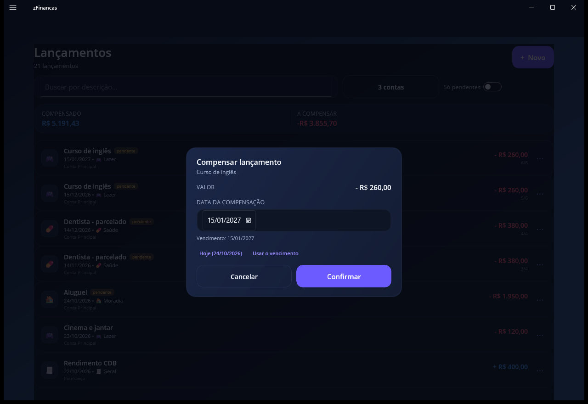

A data escolhida é gravada em `DATACOMPENSADO` — o saldo compensado passa a contar
naquele dia, não importa a data em que você registrou.

## Seleção de contas para análise

Em **Lançamentos** e **Extrato**, o botão de contas abre um painel com caixas de seleção:
marque uma, várias ou todas. Serve para conciliação e para planejar o futuro analisando
o conjunto.

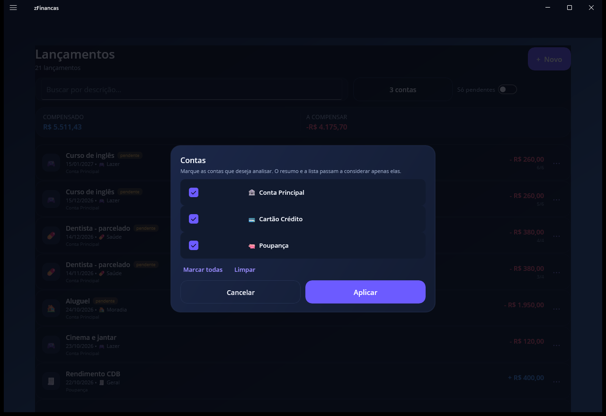

- **Lançamentos**: a lista, os totais de compensado/a compensar e as ações passam a
  considerar apenas as contas marcadas (o botão mostra “Conta Principal”, “2 contas”…).
- **Extrato**: com mais de uma conta, os saldos são **somados** (saldo anterior, final,
  compensado, entradas e saídas) e os lançamentos aparecem em ordem de vencimento com o
  **saldo consolidado** linha a linha — cada linha mostra de qual conta veio.

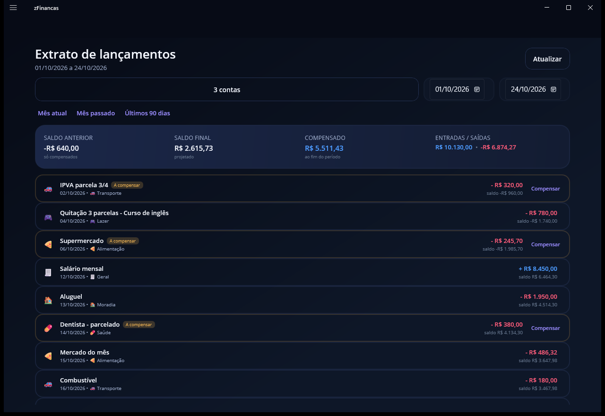

## Exclusão em lote e quitação com seleção

Na lista de lançamentos, o menu `⋯` de uma parcela oferece:

| Ação | O que faz |
| --- | --- |
| **Excluir esta parcela** | remove só a parcela aberta em questão |
| **Excluir esta e as seguintes em aberto** | remove a atual e todas as seguintes ainda pendentes (as compensadas ficam) |
| **Escolher parcelas para excluir…** | abre um **painel com caixas de seleção** e remove todas as marcadas de uma vez |
| **Quitar parcelas…** | abre o mesmo painel com as parcelas em aberto da série (já marcadas); ao confirmar, as escolhidas são excluídas e vira **um único lançamento compensado** com a soma |

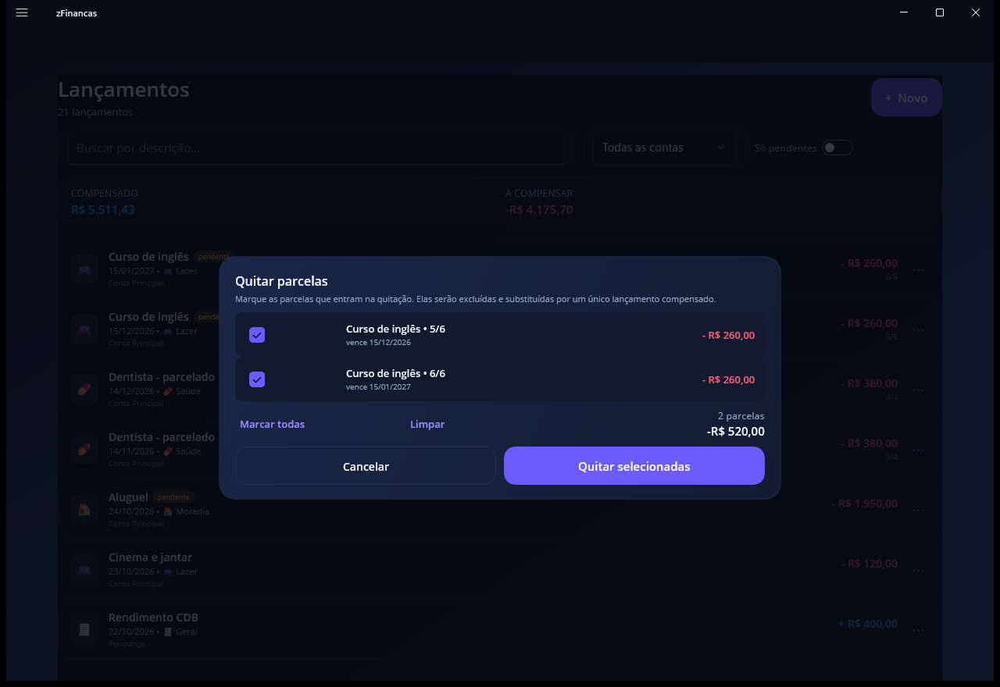

O painel mostra descrição, parcela, vencimento e valor (vermelho para despesa, azul para
recebimento), o total do que está marcado e os botões **Marcar todas / Limpar**.

## Sincronização PC ↔ celular

Sem servidor: o app gera um pacote `.zfsync` (JSON) e o outro aparelho importa.
Cada registro tem `UUID` (identidade global), `ATUALIZADOEM` (UTC) e `EXCLUIDO` (lápide),
e a mesclagem é “última escrita vence”, registro a registro, idempotente.

```
PC:      Sincronização → Exportar pacote   ──arquivo──▶  celular
Celular: Sincronização → Importar pacote   ◀──arquivo──  (e vice-versa)
```

O pacote contém hashes de senha (nunca senhas em texto claro), então trate o arquivo como
sensível. Veja [docs/SINCRONIZACAO.md](docs/SINCRONIZACAO.md).

## Testes

```
Aprovados: 52   Falhas: 0
```

Cobrem: hash de senha e código de recuperação, geração de parcelas, cálculo de saldo e
extrato, política de quitação, primeiro acesso, login/perfis, séries, quitação,
compensação, dashboard, sincronização entre dois bancos (incluindo idempotência e
conflito “última escrita vence”) e **12 testes do interpretador de voz**.

## Telas

| | |
| --- | --- |
| 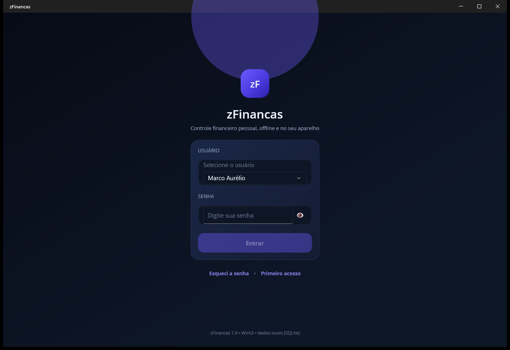 | 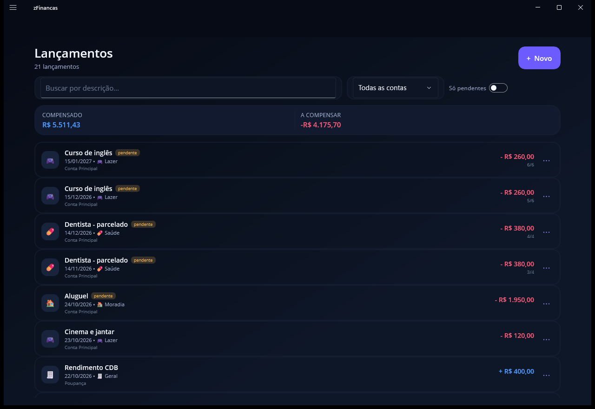 |
| 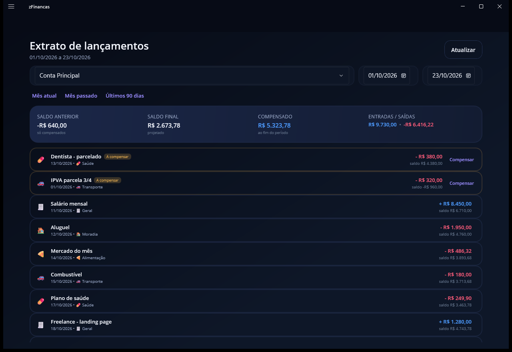 | 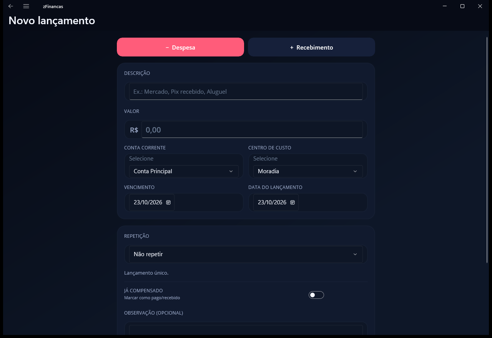 |
| 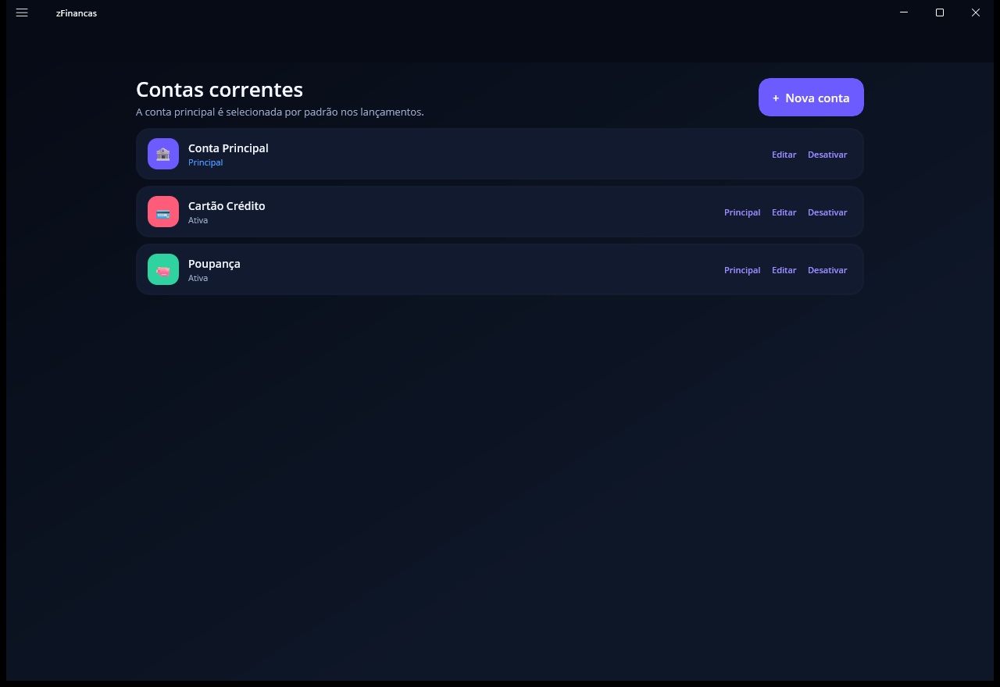 | 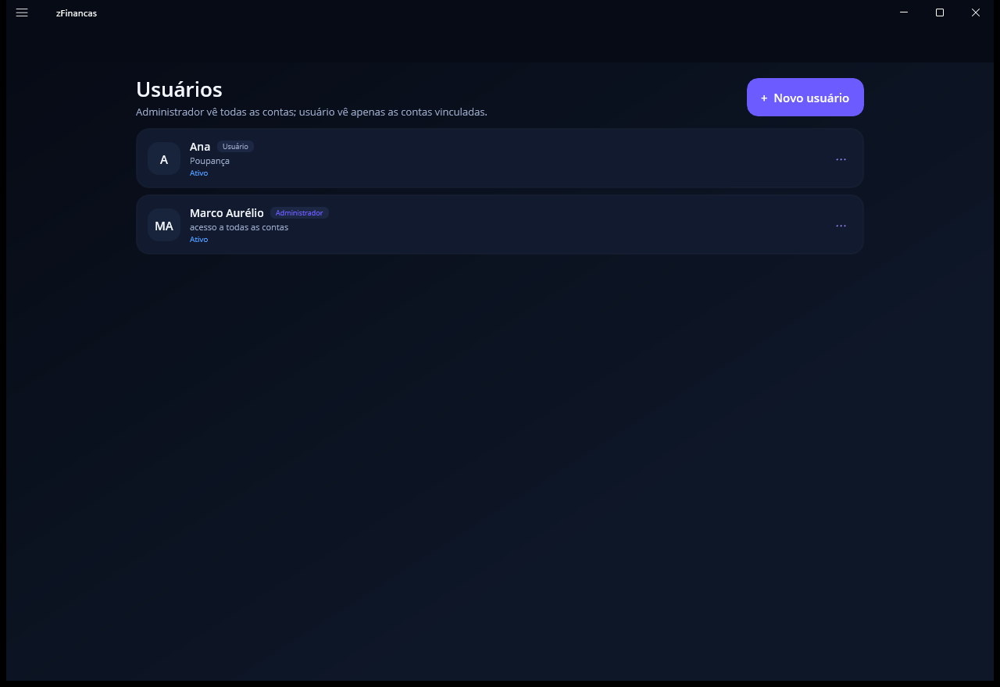 |

## Decisões e desvios conscientes

- **`SENHA` é `VARCHAR(200)`** (e não 50): guarda o hash PBKDF2, não a senha.
- **Colunas extras** em todas as tabelas sincronizáveis: `UUID`, `ATUALIZADOEM`,
  `EXCLUIDO`. `LANCAMENTO` ganhou `AGRUPADORUUID` (série global) e `OBSERVACAO`.
  `USUARIOCONTACORRENTE` ganhou `ATUALIZADOEM` e `EXCLUIDO` para propagar desvínculos.
- **`*_PRINCIPAL` da conta/centro**: garantido por serviço e por comando SQL atômico.
- **FlyoutPage + NavigationPage** em vez de Shell: o Shell do MAUI quebra no Windows com
  várias seções (`Pending Navigations still processing`).
- **Tema escuro fixo**: identidade visual igual nas duas plataformas.
- **`AGRUPADOR` numérico é local do aparelho**; o agrupamento lógico entre aparelhos usa
  `AGRUPADORUUID`.

## Fluxo de branches

| Branch | Papel |
| --- | --- |
| `main` | linha **estável**: só recebe o que já foi testado (cada merge pode virar uma tag) |
| `develop` | linha de **trabalho**: onde o desenvolvimento acontece e é testado |
| `feature/nome-curto` | opcional, para uma mudança isolada que depois entra na `develop` |

```powershell
git switch develop            # trabalhar aqui
git switch -c feature/voz-en     # mudança isolada (opcional)

# ... commits ...
git switch develop
git merge feature/voz-en         # junta na develop

# quando estiver validado:
git switch main
git merge --no-ff develop        # leva para a estável
git tag -a v1.1 -m "v1.1"        # marca a versão (opcional)
git push origin main develop --tags
```

Regra prática: `main` sempre compila e passa nos testes (`.\build.ps1 -Test`);
`develop` pode estar em andamento.

## Ajustes de celular (Android)

O layout se adapta a telas estreitas:

- **Extrato**: título sem quebra, `↻` para atualizar, contas em linha própria, resumo em 2×2 e
  compensação em um ícone `✓`;
- **Lançamentos**: título com tamanho reduzido no celular e compensação em `✓` na linha;
- **Dashboard**: botões quebram linha quando não cabem ao lado do cumprimento;
- **Centros de custo**: ícones em chips grandes (o `Picker` nativo deixava o emoji mínimo);
- **Contas**: chips de cor grandes com anel branco no selecionado;
- **Valor**: aceita `,` **e** `.` no campo (normaliza para vírgula com 2 casas), já que o
  teclado numérico do celular pode não ter vírgula.

## Solução de problemas

### `SQLite Error 8: attempt to write a readonly database`

Quase sempre é **ambiente**, não o banco. O app se defende sozinho:

1. Testa escrita **de verdade** (cria e apaga um arquivo) em cada candidato, na ordem:
   `%LOCALAPPDATA%\zFinancas` → pasta do MAUI → `%APPDATA%\zFinancas` →
   `%USERPROFILE%\zFinancas` → `%TEMP%\zFinancas` → `<pasta do exe>\App_Data`.
2. Se o arquivo do banco estiver com atributo **somente leitura**, o atributo é removido.
3. Se o arquivo existir mas o usuário não puder gravá-lo (criado por outro usuário/processo),
   o app **copia** o banco para uma pasta gravável e continua lá, sem perder dados.
4. Se `WAL` não for suportado no volume, cai para o journal padrão (`DELETE`).
5. Se nada for gravável, o app **não fecha**: abre com um aviso listando o motivo de cada
   tentativa (ex.: `Access is denied`).

O caminho em uso aparece em **Configurações → Sobre → Banco de dados**, com o botão
**Alterar pasta do banco** (salva a escolha em `Preferences`, sem variável de ambiente).
O `falhas.log` registra o caminho e uma linha por tentativa (`OK` / `FALHOU + motivo`).

Se quiser fixar por ambiente:

```powershell
$env:ZFINANCAS_DB="C:\zFinancas\dados\zfinancas.db"
```

> Em ambientes onde o perfil do usuário bloqueia escrita (política de grupo, "Controlled
> Folder Access", execução com token restrito), o banco acaba em
> `<pasta do exe>\App_Data` — funciona, mas some em um *Clean*. Nesse caso aponte uma pasta
> própria com **Alterar pasta do banco** ou com `ZFINANCAS_DB`.

### O menu lateral não navegava (corrigido)

No Windows, trocar o conteúdo principal (`Detail`) do `FlyoutPage` enquanto o painel do
menu ainda está fechando é **ignorado** pela plataforma. Agora a troca é agendada para o
próximo ciclo, depois que o painel fecha. Os itens do menu também passaram a usar
`CollectionView` + `SelectionChanged` (seleção), que é bem mais confiável que
`TapGestureRecognizer` dentro do painel no Windows.

### O carrossel de contas “deslizava” sozinho (corrigido)

O `CarouselView` do MAUI tinha comportamento instável no Windows (o cartão não parava no
lugar). No dashboard ele foi trocado por uma `CollectionView` horizontal: rolagem
previsível no mouse e no toque, com os cartões lado a lado no desktop.

### Selecionar a conta travava o app / o combo “tremia” (corrigido)

O `CarregarAsync` da tela de lançamentos **recriava a lista de contas** a cada carga. Como o
`Picker` perde a seleção quando o `ItemsSource` é limpo, ele devolvia `null` para o
`ContaSelecionada`, que disparava outra carga — um laço infinito que sacudia o combo e
congelava a interface.

Correções:

- a coleção de opções do `Picker` é montada **uma única vez** e mantida estável;
- troca de seleção feita pelo código **não** dispara nova carga (`_aplicandoSelecao`);
- cargas simultâneas são enfileiradas (`_recarregarPendente`), então a busca por texto não
  perde a última digitação;
- o mesmo tratamento foi aplicado ao **Extrato**, que tinha o mesmo padrão.

### O app abre no "Primeiro acesso" mesmo eu já tendo usuário

O banco mudou de lugar (ou foi apagado). O app migra automaticamente o arquivo da pasta
antiga do MAUI; se quiser o banco de demonstração, rode `tools\zFinancas.Demo` e aponte
`ZFINANCAS_DB` para o arquivo gerado.

### Onde ficam meus dados

`%LOCALAPPDATA%\zFinancas\zfinancas.db` (Windows) ou a pasta privada do app (Android).
Basta copiar esse arquivo para fazer backup.

## Limitações conhecidas / próximos passos

- Biometria foi implementada no Android (`BiometricPrompt` nativo, sem plugins) e precisa
  ser validada em aparelho real.
- Voz: a captura real usa o reconhecedor do sistema e **precisa ser validada em aparelho
  com microfone**; a interpretação da frase está coberta por testes e pode ser exercitada
  no desktop com `ZFINANCAS_VOZ`.
- Sincronização por arquivo é manual; um próximo passo natural é transferência por rede
  local (mDNS/HTTP) mantendo o mesmo pacote.
- Sem exclusão definitiva (purge) de lápides antigas.

## Documentação

- [Arquitetura](docs/ARQUITETURA.md)
- [Regras de negócio](docs/REGRAS-DE-NEGOCIO.md)
- [Sincronização](docs/SINCRONIZACAO.md)

